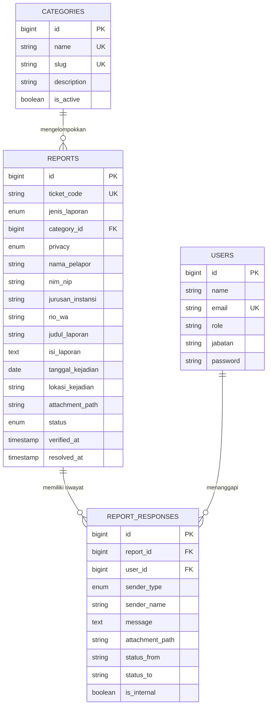

<div align="center">
  <br />
  <picture>
    <source media="(prefers-color-scheme: dark)" srcset="docs/brand/silira-logo-dark.svg" />
    <source media="(prefers-color-scheme: light)" srcset="docs/brand/silira-logo-light.svg" />
    
  </picture>
  <br /><br />
  <p>
    <strong>Sistem Integrasi Layanan Interaksi dan Respon Aspirasi</strong><br />
    Portal aspirasi, pengaduan, dan permintaan informasi mahasiswa untuk program kerja<br />
    Dewan Perwakilan Mahasiswa (DPM) Fakultas Dakwah dan Ilmu Komunikasi.
  </p>

  <p>
    
    
    
    
  </p>

  <p>
    <a href="#mengapa-silira">Mengapa Silira</a> &middot;
    <a href="#fitur-utama">Fitur</a> &middot;
    <a href="#skema-database">Database</a> &middot;
    <a href="#instalasi-lokal">Instalasi</a> &middot;
    <a href="#kontribusi--komunitas">Kontribusi</a>
  </p>
</div>

---

## Latar Belakang & Riwayat Versi

- **`v1-php-native` (November 2024)** — Prototipe awal berbasis PHP Native, MySQLi, dan Bootstrap 4. Diarsipkan secara utuh pada Git tag [`v1-php-native`](../../releases/tag/v1-php-native).
- **`v2` (Laravel)** — Refactor menyeluruh ke Laravel untuk menghadirkan pelacakan kode tiket tanpa login, interaksi dua arah, kontrol privasi tiga tingkat, autentikasi pengurus, dan dokumentasi tindak lanjut lintas periode.

## Mengapa Silira

Google Form efektif untuk mengumpulkan data satu arah ke spreadsheet, tetapi pengelolaan aspirasi mahasiswa membutuhkan alur tindak lanjut yang terukur:

| Aspek | Google Form | Silira |
| :--- | :--- | :--- |
| **Kepastian status** | Berhenti di tombol *Submit* | Kode tiket unik (`SLR-YYYY-XXXXXX`) dengan status real-time tanpa login |
| **Komunikasi** | Satu arah | Interaksi dua arah & lampiran tambahan langsung pada halaman tiket |
| **Kontrol privasi** | Masuk sheet internal tanpa opsi publik | Tiga tingkat privasi: `Publik`, `Anonim`, dan `Rahasia` |
| **Estafet pengurus** | Rekap manual di spreadsheet | Dashboard metrik, catatan internal DPM terpisah, & ekspor CSV terfilter |

---

## Fitur Utama

### Portal Publik (Tanpa Login)
- **Formulir Aspirasi & Pengaduan** (`/lapor`) — Klasifikasi (`Aspirasi`, `Pengaduan`, `Permintaan Informasi`), kategori bidang dengan pencarian, opsi privasi tiga tingkat, serta upload bukti (JPG/PNG/WEBP/PDF maks. 5 MB).
- **Kode Tiket & Bukti Lapor** (`/lapor/sukses/{ticketCode}`) — Kode unik otomatis dengan tombol salin dan mode cetak bukti.
- **Pelacakan & Interaksi Dua Arah** (`/lacak`) — Progress bar 4 tahap (`Menunggu` → `Diverifikasi` → `Diproses` → `Selesai`), timeline respon resmi DPM, dan balasan lanjutan dari pelapor.
- **Direktori Aspirasi Publik** (`/aspirasi`) — Transparansi laporan `Publik` dan `Anonim` dengan pencarian serta filter kategori, klasifikasi, dan status.

### Portal Admin DPM (`/admin`)
- **Dashboard Operasional** — Ringkasan metrik, tingkat penyelesaian, distribusi kategori bidang, klasifikasi, dan komposisi status.
- **Manajemen & Tindak Lanjut Laporan** — Pencarian, filter multi-kriteria, pembaruan status, tanggapan resmi, **Catatan Internal DPM** (tidak tampil ke pelapor), tautan WhatsApp langsung, edit, hapus, serta ekspor CSV (UTF-8 BOM untuk Excel).
- **Pengelolaan Master Data** — CRUD kategori bidang dan manajemen akun pengurus DPM.

---

## Arsitektur & Struktur Direktori

```text
app/
├── Http/Controllers/
│   ├── HomeController.php              # Beranda & feed aspirasi publik
│   ├── ReportController.php            # Form kirim laporan & bukti kode tiket
│   ├── TrackingController.php          # Pelacakan kode tiket & balasan 2 arah
│   └── Admin/
│       ├── AuthController.php          # Autentikasi pengurus DPM
│       ├── DashboardController.php     # Metrik & distribusi laporan
│       ├── ReportController.php        # CRUD, tindak lanjut, catatan internal, export CSV
│       ├── CategoryController.php      # Kelola kategori bidang
│       └── UserController.php          # Kelola akun pengurus & ganti kata sandi
└── Models/
    ├── Category.php
    ├── Report.php
    ├── ReportResponse.php
    └── User.php

database/
├── migrations/                         # Skema users, categories, reports, report_responses
└── seeders/DatabaseSeeder.php          # Data demo kategori, akun DPM, & contoh tiket

resources/views/
├── components/                         # brand-logo, select-dropdown
├── layouts/                            # public.blade.php, admin.blade.php
├── public/                             # home, create, success, track, feed
└── admin/                              # login, dashboard, reports/*, categories/*, users/*
```

---

## Skema Database



### Penjelasan Tabel Inti
- **`users`** — Akun pengurus DPM (`superadmin` dan `admin_dpm`) dengan kata sandi terenkripsi bcrypt.
- **`categories`** — Bidang tujuan laporan yang dapat diaktifkan/dinonaktifkan dari panel admin.
- **`reports`** — Entitas laporan utama dengan `ticket_code` unik, mode privasi (`public`, `anonymous`, `confidential`), dan status alur (`menunggu`, `diverifikasi`, `diproses`, `selesai`, `ditolak`).
- **`report_responses`** — Timeline histori status, tanggapan resmi DPM, balasan dua arah pelapor, serta catatan internal (`is_internal = true`) yang terisolasi dari halaman publik.

---

## Referensi Route

| Akses | Method & Path | Fungsi |
| :--- | :--- | :--- |
| Publik | `GET /` | Beranda, live preview tiket, & aspirasi terbaru |
| Publik | `GET /lapor`, `POST /lapor` | Formulir pengiriman laporan tanpa login |
| Publik | `GET /lapor/sukses/{ticketCode}` | Konfirmasi & bukti cetak kode tiket |
| Publik | `GET /lacak`, `GET /lacak/{ticketCode}` | Pelacakan status & timeline progres |
| Publik | `POST /lacak/{ticketCode}/reply` | Tanggapan dua arah dari pelapor |
| Publik | `GET /aspirasi` | Direktori aspirasi publik & filter |
| Admin | `GET /admin/login`, `POST /admin/login` | Autentikasi pengurus DPM |
| Admin | `GET /admin` | Dashboard metrik & distribusi |
| Admin | `GET /admin/laporan`, `GET /admin/laporan/{report}` | Manajemen, filter, & detail laporan |
| Admin | `POST /admin/laporan/{report}/respon` | Update status, respon resmi, / catatan internal |
| Admin | `GET /admin/laporan-export` | Export CSV (UTF-8 BOM) mengikuti filter aktif |
| Admin | `GET /admin/kategori`, `GET /admin/akun` | Pengelolaan kategori bidang & akun pengurus |

---

## Instalasi Lokal

### Prasyarat
- PHP 8.2+ (ekstensi `pdo_sqlite` / `pdo_mysql`, `fileinfo`, `mbstring`, `gd`)
- Composer 2+
- Node.js 20+ & npm

### Langkah Setup
```bash
git clone https://github.com/anwarpage/silira.git
cd silira

composer install
npm install

cp .env.example .env
php artisan key:generate

php artisan migrate --seed
php artisan storage:link

npm run build
php artisan serve
```

Aplikasi berjalan di `http://127.0.0.1:8000`.

### Konfigurasi MySQL (Opsional)
Secara default pengembangan lokal menggunakan SQLite (`database/database.sqlite`). Untuk menggunakan MySQL, sesuaikan `.env`:

```env
DB_CONNECTION=mysql
DB_HOST=127.0.0.1
DB_PORT=3306
DB_DATABASE=silira_db
DB_USERNAME=root
DB_PASSWORD=
```

Lalu jalankan `php artisan migrate --seed`.

---

## Akun & Data Demo (Seeder)

### Akun Admin DPM (`/admin/login`)

| Peran | Email | Password |
| :--- | :--- | :--- |
| Super Admin (Komisi Aspirasi) | `admin@silira.ac.id` | `password123` |
| Admin DPM (Sekretariat) | `sekretariat@silira.ac.id` | `password123` |

### Contoh Kode Tiket (`/lacak`)

| Kode Tiket | Klasifikasi | Privasi | Status |
| :--- | :--- | :--- | :--- |
| `SLR-2026-FDIK01` | Pengaduan | Publik | Selesai |
| `SLR-2026-FDIK02` | Aspirasi | Anonim | Sedang Diproses |
| `SLR-2026-FDIK03` | Permintaan Informasi | Publik | Diverifikasi |
| `SLR-2026-FDIK04` | Pengaduan | Rahasia | Menunggu Verifikasi |

---

## Pengujian

Seluruh alur utama diuji otomatis pada `tests/Feature/SiliraWorkflowTest.php`:

```bash
php artisan test
```

---

## Kontribusi & Komunitas

Kontribusi dari pengembang, mahasiswa, maupun pengurus organisasi kampus sangat terbuka:

- **Laporan Bug & Usulan Fitur** — Buka [GitHub Issues](https://github.com/anwarpage/silira/issues) dengan langkah reproduksi atau konteks kebutuhan yang jelas.
- **Pull Request** — Baca alur branch, konvensi commit, dan checklist pengujian pada [CONTRIBUTING.md](CONTRIBUTING.md).
- **Keamanan** — Jika menemukan celah keamanan terkait privasi laporan atau autentikasi, hindari mempublikasikan detail eksploitasi secara terbuka dan hubungi pengelola repositori secara langsung.

## Lisensi

Dirilis di bawah lisensi [MIT](LICENSE).
